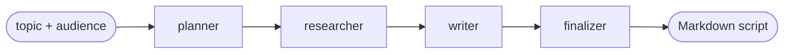

# Proofline

[](https://github.com/hassanmansour-dev/ProofLine/actions/workflows/ci.yml)

**An eval-gated, multi-agent content pipeline built with LangGraph. Nothing ships
without passing the evals and a human sign-off.**

Give Proofline a topic and an audience. It plans an angle, researches it, writes a
short technical script with inline citations, and formats the result: a title, a
hook, a body and a call to action, under 200 words. The same script works as a
LinkedIn post and as a 1-minute video about AI engineering.

Built in public, October 2026 → January 2027. This is Week 1: the linear flow. The
[roadmap](#roadmap) shows where it goes next: a critic loop, human review, an API,
tracing, parallel research agents, a fact-checker, MCP servers, then evals in CI,
cost budgets and prompt-injection defenses.

## How it works (Week 1)



| Node | Does | Output |
|---|---|---|
| **planner** | Picks one angle for this audience; writes answerable questions, search queries and 2–4 beats | `Outline` (structured output) |
| **researcher** | Calls whatever `Researcher` is configured: fixed notes this week, a web-search agent from Week 5 | `ResearchNotes` with source ids `S1..Sn` assigned in code |
| **writer** | Writes the script from the outline and notes; every claim cites a source; asks itself for one cut if it runs over the limit | `Draft` (title, hook, body, call to action) |
| **finalizer** | Renders Markdown with the cited sources; saves `outputs/<run-id>/script.md` and `script.json` | `FinalScript` |

Things a reviewer may want to check:
- **Every node gets its dependencies from LangGraph's runtime context** (an LLM port
  and a `Researcher` port), never from globals. The whole graph runs in tests with a
  fake model in milliseconds.
- **Derived numbers are computed in code, never asked of the model:** word count,
  cited sources, and later the critic's overall score.
- **Source ids come from code, and citations to ids that don't exist are dropped.**
  Web content reaches the model escaped, inside tags, as data and never as
  instructions.
- **Prompts are versioned files** with a changelog (`packages/proofline/src/proofline/prompts/`).
- **Decisions are recorded** as ADRs in [`docs/adr/`](docs/adr/).

## Two packages, one repo

```
packages/
  proofline/        the pipeline app: graph, nodes, CLI (API from Week 3)
  measured_evals/   the eval + security layer (skeleton now; built in weeks 9–11)
```

The evaluation and security code lives in its own installable package,
`measured-evals`, from day one, and **it never imports Proofline**:

- **It's reused.** A separate web app (Measured Lab) will sit on the same
  package, and it will be published as open source. Code that knows about
  Proofline's schemas can't be either.
- **Evals have to be independent of what they judge.** A metric that reaches into
  the pipeline's internals ends up grading itself.
- **Splitting later is expensive.** Starting split costs one `pyproject.toml`;
  untangling the imports in Week 10 would cost a week.

The boundary is enforced, not just intended. `packages/measured_evals/tests/test_boundary.py`
fails if the package declares or imports `proofline`, and CI installs
`measured_evals` on its own, without the app, and runs its tests. Dependencies point
one way: `proofline` → `measured_evals`. Details: [ADR-0012](docs/adr/0012-workspace-split-and-week1-reset.md).

## Run it

Requires [uv](https://docs.astral.sh/uv/) and Python 3.12+.

```bash
uv sync                                   # installs both packages + dev tools
cp .env.example .env                      # add ANTHROPIC_API_KEY
uv run proofline run --topic "Why every AI loop needs an exit" --audience "developers new to AI"
```

The script prints to stdout and is saved under `outputs/<run-id>/`. Add `-v` to see
one log line per node. `uv run proofline mermaid` prints the graph.

Configuration comes from environment variables (see [`.env.example`](.env.example)):

| Variable | Default | What |
|---|---|---|
| `ANTHROPIC_API_KEY` | — | Required for real runs |
| `PROOFLINE_LLM_PROVIDER` | `anthropic` | Model provider (adapters live in `llm.py`) |
| `PROOFLINE_PLANNER_MODEL`, `_WRITER_MODEL`, … | Haiku / Sonnet | Model per node role |
| `PROOFLINE_BRAND_NAME` | `Build Clearly` | Brand the scripts are written for |
| `PROOFLINE_MAX_WORDS` | `200` | Word limit for the script |
| `PROOFLINE_RESEARCHER` | `stub` | `stub` = fixed notes, no network; `web` = Tavily search (needs `TAVILY_API_KEY`) |

The voice the writer follows lives in [`docs/BRAND_VOICE.md`](docs/BRAND_VOICE.md).

## Develop

```bash
uv run pytest                 # both packages; live tests skip without API keys
uv run pytest -m live         # real model + search calls (costs money)
uv run ruff check . && uv run ruff format --check .
uv run mypy                   # strict, on both packages
```

Unit tests never touch the network: nodes run inside a real one-node graph with a
fake model, and their updates are read back from a checkpointer, so serialization
problems show up in tests. CI runs ruff, mypy and pytest on both packages on every
push and pull request.

## Roadmap

| Week | Dates | Milestone |
|---|---|---|
| **1** | Oct 26 – Nov 1 | **Linear flow**, two-package workspace, CLI, CI ◀ now |
| 2 | Nov 2 – 8 | Critic scores against a rubric; the writer revises until good enough, with a revision guard |
| 3 | Nov 9 – 15 | Human review via `interrupt()`; checkpointer (resume after a crash); FastAPI endpoint |
| 4 | Nov 16 – 22 | LangSmith tracing, run report, full README · `v0.1.0` |
| 5 | Nov 23 – 29 | Supervisor + web-search researcher agent (replaces the stub, same interface) |
| 6 | Nov 30 – Dec 6 | Parallel researcher agents (web, docs/GitHub) with fan-out and merge |
| 7 | Dec 7 – 13 | Independent fact-checker agent on a different model |
| 8 | Dec 14 – 20 | MCP servers: read-only knowledge over past scripts · `v0.2.0` |
| 9 | Dec 21 – 27 | Golden set of 20 topics (`measured_evals`) |
| 10 | Dec 28 – Jan 3 | DeepEval metrics + promptfoo regression checks in CI |
| 11 | Jan 4 – 10 | Cost budgets, prompt-injection suite, API auth and rate limiting · `v0.3.0` |
| 12 | Jan 11 – 17 | Case study + demo video |
| 13 | Jan 18 – 24 | Public launch: repo public, `measured-evals` on PyPI · `v1.0.0` |

Week-by-week detail: [`docs/PLAN.md`](docs/PLAN.md). Architecture:
[`docs/ARCHITECTURE.md`](docs/ARCHITECTURE.md).

## Repository layout

```
packages/proofline/src/proofline/   state, schemas, nodes/, research/, prompts/, graph, cli
packages/proofline/tests/           unit tests (fakes) + live tests
packages/measured_evals/            standalone eval + security package
docs/                               plan, architecture, ADRs, rubric, prompting standards
.claude/                            Claude Code setup: hooks, review agents, skills
```

Built by Hassan Mansour on his own time, as a public portfolio project.
