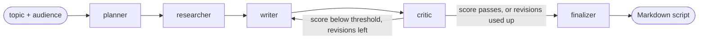
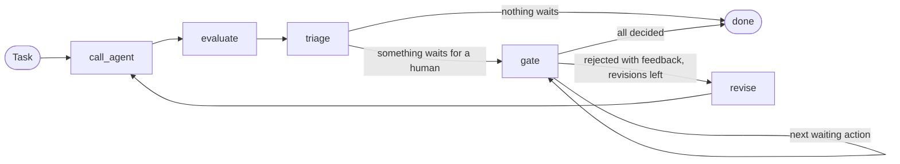

# Proofline

[](https://github.com/hassanmansour-dev/ProofLine/actions/workflows/ci.yml)

**An eval-gated, multi-agent content pipeline built with LangGraph. Nothing ships
without passing the evals and a human sign-off.**

Give Proofline a topic and an audience. It plans an angle, researches it, writes a
short technical script with inline citations, and formats the result: a title, a
hook, a body and a call to action, under 140 words. The same script works as a
LinkedIn post and as a 1-minute video about AI engineering.

Built in public. **Proofline v1 is Measured Ops** ([ADR-0013](docs/adr/0013-measured-ops-is-proofline-v1.md)):
a LangGraph supervisor with specialist agents that runs a real work plan, with a
human approving anything public, any deploy, any spend and any message to a real
person. The content pipeline is its first agent.

## Status: what works today

Everything in this table is in `main` and covered by the fast test suite (no keys,
no network). Nothing here publishes, deploys, spends or messages anyone.

| Piece | Where | State |
|---|---|---|
| Content pipeline with a critic loop | `packages/proofline` (`graph.py`, `routing.py`) | Works: plan → research → write → critique → revise or finalize |
| Content agent | `proofline/agent.py` | Works: one topic becomes one `approve_draft` action (LinkedIn post, 1-minute clip script, lesson outline). It never publishes |
| Supervisor and approval gate | `measured_ops/supervisor.py` | Works: `call_agent → evaluate → triage → gate`, paused with `interrupt()`, resumed from a checkpoint (SQLite or Postgres) |
| Eval/guard node | `measured_evals/checks.py`, run by the supervisor | Works: deterministic quality, prompt-injection and PII checks (guard-v0). No model |
| Approval inbox, phone-sized | `measured_ops/inbox/` | Works: sign-in, list, preview with checks and cost, approve or reject with feedback, Ready to paste |
| Golden set, 20 topics | `measured_evals/data/golden/content_v0.toml` | **Draft, unapproved.** Every item is `needs_eval` ([`docs/GOLDEN_SET.md`](docs/GOLDEN_SET.md)) |
| Deterministic eval tier | `python -m measured_evals run`, `.github/workflows/evals.yml` | Works in CI with a fake writer. **It measures no model** |
| Regression baseline | `evals/baselines/content_v0.placeholder.json` | **Placeholder.** Reported, never enforced ([`docs/EVALS.md`](docs/EVALS.md)) |

Not built yet: MCP tools (Jira and calendar), scheduled runs with budget caps and a
kill switch, more agents, the model-graded eval tier, and the full injection suite.
No eval score for a real model or for this pipeline is published in this repo. See
the [roadmap](#roadmap).

## How it works today

### The content pipeline



| Node | Does | Output |
|---|---|---|
| **planner** | Picks one angle for this audience; writes answerable questions, search queries and 2–4 beats | `Outline` (structured output) |
| **researcher** | Calls whatever `Researcher` is configured: fixed notes (`stub`, the default) or Tavily web search (`web`) | `ResearchNotes` with source ids `S1..Sn` assigned in code |
| **writer** | Writes the script from the outline and notes; every claim cites a source; on a revision it gets the critic's fixes | `Draft` (title, hook, body, call to action) |
| **critic** | Scores the draft on eight criteria from [`docs/RUBRIC.md`](docs/RUBRIC.md), each with a quote as evidence and a concrete fix | `Critique`; the overall score is computed in Python |
| **finalizer** | Renders Markdown with the cited sources; saves `outputs/<run-id>/script.md` and `script.json` | `FinalScript` |

The loop has two exits, both decided by a pure function
(`routing.route_after_critic`): the score reaches `PROOFLINE_SCORE_THRESHOLD`
(default 8.0), or `PROOFLINE_MAX_REVISIONS` (default 3) is used up. A recursion
limit is the backstop. A draft that runs out of revisions is still finalized, with
its score; the human at the gate sees it.

### The supervisor and the approval gate



- **call_agent** runs one agent, a LangGraph subgraph that takes a `Task` and returns
  an `AgentResult` with the actions it proposes. Agents are injected, never imported
  by the supervisor.
- **evaluate** runs `measured_evals.evaluate()` on each proposed action's preview
  and target, and attaches the scores. A missing or failed score raises an "auto" action to
  approval; it never lowers anything ([ADR-0018](docs/adr/0018-eval-guard-node.md)).
- **triage** applies the policy table: `auto` goes straight to `ready`, `approval`
  waits, `never` is blocked and logged (no approval unblocks it). An action type the
  table doesn't know always waits. **Nothing in `ready` executes yet**: there are no
  tools or executors until C5, so today an approved action is a recorded decision.
- **gate** pauses with `interrupt()`. The answer is validated before it is saved, so
  a bad answer leaves the run paused ([ADR-0016](docs/adr/0016-supervisor-graph-and-approval-gate.md)).
- **revise** turns a rejection with feedback into a new task in the same thread, up
  to 3 revisions by default ([ADR-0019](docs/adr/0019-content-agent-and-revision-loop.md)).

The inbox ([`docs/INBOX.md`](docs/INBOX.md), [ADR-0017](docs/adr/0017-approval-inbox.md))
is a small server-rendered web page with no JavaScript. It binds to `127.0.0.1`,
needs a passphrase, and is meant to be reached from a phone over a private tailnet,
never the public internet. Each waiting action shows its checks and the run's cost
per agent. Approving a content draft only moves it to **Ready to paste**; a human
copies and posts it ([ADR-0020](docs/adr/0020-ready-to-paste-and-explicit-reject.md)).

Things a reviewer may want to check:
- **Every node gets its dependencies from LangGraph's runtime context** (an LLM port
  and a `Researcher` port), never from globals. The whole graph runs in tests with a
  fake model in milliseconds.
- **Derived numbers are computed in code, never asked of the model:** word count,
  cited sources, the critic's overall score, and whether an eval passed.
- **Source ids come from code, and citations to ids that don't exist are dropped.**
  Web content reaches the model escaped, inside tags, as data and never as
  instructions.
- **Check reasons never quote the matched text**, so a personal value can't leak
  into scores, logs, traces or the approval screen.
- **Prompts are versioned files** with a changelog (`packages/proofline/src/proofline/prompts/`).
- **Decisions are recorded** as ADRs in [`docs/adr/`](docs/adr/).

## Three packages, one repo

```
packages/
  proofline/        the content pipeline and the content agent: graph, nodes, CLI
  measured_ops/     Measured Ops: contracts, agent interface, approval policy,
                    supervisor and approval gate, approval inbox
  measured_evals/   the eval + security layer: guard checks, cost, golden-set
                    format, deterministic eval tier, baseline format
```

Every agent is a LangGraph subgraph that takes a `Task` and returns an
`AgentResult` with the actions it proposes. A policy table decides which actions run
on their own, which wait for a human, and which are never allowed (blocked and
logged; no approval unblocks them). An action type the table doesn't know always waits. Details: [ADR-0014](docs/adr/0014-measured-ops-package-and-approval-ownership.md).

The evaluation and security code lives in its own installable package,
`measured-evals`, from day one, and **it never imports Proofline**:

- **It's reused.** A separate web app (Measured Lab) will sit on the same
  package, and it will be published as open source. Code that knows about
  Proofline's schemas can't be either.
- **Evals have to be independent of what they judge.** A metric that reaches into
  the pipeline's internals ends up grading itself.
- **Splitting later is expensive.** Starting split costs one `pyproject.toml`;
  untangling the imports later would cost far more.

The boundary is enforced, not just intended. `packages/measured_evals/tests/test_boundary.py`
fails if the package declares or imports `proofline` or `measured_ops`, and CI installs
`measured_evals` on its own, without the app, and runs its tests. Dependencies point
one way: `proofline` → `measured_ops` → `measured_evals`. Details: [ADR-0012](docs/adr/0012-workspace-split-and-week1-reset.md).

## Run it

Requires [uv](https://docs.astral.sh/uv/) and Python 3.12+.

```bash
uv sync                                   # installs all three packages + dev tools
cp .env.example .env                      # add ANTHROPIC_API_KEY
uv run proofline run --topic "Why every AI loop needs an exit" --audience "developers new to AI"
```

The script prints to stdout and is saved under `outputs/<run-id>/`. Add `-v` to see
one log line per node. `uv run proofline mermaid` prints the graph. With the default
`PROOFLINE_RESEARCHER=stub` the research is fixed sample notes, not research on your
topic; the CLI says so.

With the approval gate and the inbox (set the two inbox secrets first:
[`docs/INBOX.md`](docs/INBOX.md)):

```bash
uv run proofline inbox                                    # serve the inbox on 127.0.0.1
uv run proofline propose --topic "..." --audience "..."   # one draft, paused at the gate
uv run proofline ready                                    # approved drafts, as Markdown to paste
```

Without any key, the eval layer runs on its own:

```bash
uv run python -m measured_evals run                          # deterministic tier, fake writer, draft golden set
uv run python -m measured_evals run --writer fake-careless   # a bad fake: must fail
```

Configuration comes from environment variables (see [`.env.example`](.env.example)):

| Variable | Default | What |
|---|---|---|
| `ANTHROPIC_API_KEY` | — | Required for real runs |
| `PROOFLINE_LLM_PROVIDER` | `anthropic` | Model provider (adapters live in `llm.py`) |
| `PROOFLINE_PLANNER_MODEL`, `_WRITER_MODEL`, … | Haiku / Sonnet | Model per node role |
| `PROOFLINE_BRAND_NAME` | `Build Clearly` | Brand the scripts are written for |
| `PROOFLINE_MAX_WORDS` | `140` | Word limit for the script (about 56 s spoken) |
| `PROOFLINE_RESEARCHER` | `stub` | `stub` = fixed notes, no network; `web` = Tavily search (needs `TAVILY_API_KEY`) |
| `PROOFLINE_SCORE_THRESHOLD` | `8.0` | Critic score (out of 10) at which the loop stops revising |
| `PROOFLINE_MAX_REVISIONS` | `3` | Revision budget for the critic loop |
| `MEASURED_OPS_INBOX_*` | — | Inbox passphrase hash, session secret and paths ([`docs/INBOX.md`](docs/INBOX.md)) |

The voice the writer follows lives in [`docs/BRAND_VOICE.md`](docs/BRAND_VOICE.md).

## Develop

```bash
uv run pytest                 # every package; live tests skip without API keys
uv run pytest -m live         # real model + search calls (costs money)
uv run ruff check . && uv run ruff format --check .
uv run mypy                   # strict, on every package
```

Unit tests never touch the network: nodes run inside a real one-node graph with a
fake model, and their updates are read back from a checkpointer, so serialization
problems show up in tests. On every push and pull request, CI runs a secret and PII
scan, ruff, mypy and pytest on every package, the supervisor's end-to-end test
against a Postgres service, and installs `measured_evals` and `measured_ops` on
their own to prove the package boundaries. A second workflow, Evals, runs the
deterministic eval tier.

## Evals: what is real and what is not

Two tiers are planned ([`docs/EVALS.md`](docs/EVALS.md)). Checks computed in code run
first, on everything, for free. Model-graded checks cost a call and vary between
runs, so they come second and only when a key is present.

- **Deterministic tier: in CI.** Structure, word limit, citations that resolve, no
  uncited body sentences, then each golden item's own assertions.
- **Golden set: draft, unapproved.** 20 topics (15 standard, 3 with injection bait,
  2 unanswerable) with fixture sources written as demo data. Until its owner
  approves an item, no result against it is a quality claim.
- **Baseline: placeholder.** It came from a fake writer that assembles text from
  the fixture sources and passes by construction. It shows the set, the suite and
  the format agree with each other. The comparison prints `NOT ENFORCED` and gates
  nothing until a reviewed, real baseline replaces it.
- **Model-graded tier: not built.** The `judge` assertions in the golden set don't
  run yet.

## Roadmap

Ordered steps, no dates. Each starts when the steps it depends on are done.

| Step | Milestone |
|---|---|
| ✅ | Linear flow, uv workspace, CLI, CI |
| ✅ C1 | Contract: shared state, agent interface, approval actions (auto / approval / never), eval interface |
| ✅ C0 | One-command bootstrap and the private ops repo; secret + PII scan on every commit |
| ✅ C2 | Supervisor with checkpointer, approval interrupt, end-to-end test in CI |
| ✅ C3–C4 | Policy table reviewed; approval inbox for the phone |
| ✅ C7 | Eval/guard node, masked tracing, usage and cost per agent run |
| ✅ C8 | Content agent: one topic → post, clip script, lesson outline, checked and waiting for approval; critic loop; revisions on rejection |
| **C5** ◀ now | MCP tools: Jira and a personal calendar, reads free, every write through the approval policy |
| C9 | A week of real use (runs alongside C5) |
| C10 | Scheduled runs with budget caps and a kill switch |
| C11 | More agents, one at a time, same recipe |
| Evals | Golden set drafted and deterministic tier in CI (done, set unapproved); next: approved set and real baseline, model-graded tier (DeepEval + promptfoo), injection suite, budgets, auth |
| Launch | Case study, demo video, licence, `measured-evals` on PyPI · `v1.0.0` |

Step detail: [`docs/PLAN.md`](docs/PLAN.md). Architecture:
[`docs/ARCHITECTURE.md`](docs/ARCHITECTURE.md).

## Repository layout

```
packages/proofline/src/proofline/   state, schemas, nodes/, research/, prompts/, graph, cli
packages/proofline/tests/           unit tests (fakes) + live tests
packages/proofline/src/proofline/agent.py   the content agent (Task → approve_draft)
packages/measured_ops/              contracts, policy (+ demo table), supervisor, inbox/
packages/measured_evals/            checks, cost, golden set (draft), suites, baseline
evals/baselines/                    the placeholder baseline
docs/                               plan, architecture, ADRs, rubric, evals, golden set, inbox
.claude/                            Claude Code setup: hooks, review agents, skills
```

Everything in this repo is demo config and sample data. No licence has been chosen
yet; one will be added at launch.

Built by Hassan Mansour on his own time, as a public portfolio project.
