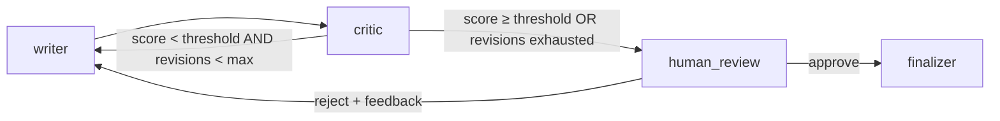

# Architecture — Proofline

Status: **Week 1, linear flow** (ADR-0012). Later weeks are marked ⟶ so the
design doesn't need to be torn up when they land.

## 1. What it does

Input: a topic and an audience. Output: one short technical script (title, hook,
body, call to action; at most 200 words by default) for a LinkedIn post and a
1-minute video, with inline citations, saved as Markdown + JSON.

A human is the final gate (Week 3). The machine's job is to get a draft good enough
that review is a 2-minute read, not a rewrite.

## 2. Two packages, one workspace

```
packages/
  proofline/        the pipeline app (LangGraph graph, nodes, CLI, API)
  measured_evals/   eval + security layer: golden sets, metrics, cost budgets,
                    prompt-injection tests (empty skeleton until Phase 3)
```

Dependencies point one way: **proofline → measured_evals**, never back.
`measured_evals` is published as open source at launch and reused by a separate
web app (Measured Lab), so it can't know anything about Proofline.
`packages/measured_evals/tests/test_boundary.py` fails if it declares or imports
`proofline`, and CI installs it alone (no app) and runs its tests (ADR-0012).

## 3. Graph

Week 1 (now):


⟶ Weeks 2–3 add the critic loop and human review:



Routing is two pure functions in `routing.py` (already implemented and tested):

| Router | Reads | Returns |
|---|---|---|
| `route_after_critic` | `score`, `revision_count`, `run_config` | `"writer"` \| `"human_review"` |
| `route_after_human` | `approved` | `"writer"` \| `"finalizer"` |

`revision_count` = number of writer passes **after** the first draft. Backstop:
every invocation passes `recursion_limit` (default 40).

`build_graph()` uses the full `ScriptState` as its input schema: a narrower input
schema would drop the defaults `initial_state()` sets for later-week fields.

## 4. State

`state.py` — `ScriptState(TypedDict, total=False)`. TypedDict for the graph,
Pydantic for every value (ADR-0002). `initial_state(topic, audience, run_config)`
sets every default.

| Field | Type | Written by | Default / notes |
|---|---|---|---|
| `topic`, `audience` | `str` | input | |
| `run_config` | `RunConfig` | input | settings snapshot (models, thresholds, `max_words`, `brand_name`) so a resumed run behaves like it started (ADR-0004) |
| `outline` | `Outline` | planner | angle, key questions, search queries, 2–4 beats |
| `research_notes` | `ResearchNotes` | researcher | sources with code-assigned ids `S1..Sn`, findings citing them, gaps |
| `draft` | `Draft` | writer | title/hook/body/CTA; cited ids, word count, duration derived from the text |
| `revision_count` | `int` | writer | 0 |
| `critique` | `Critique \| None` | critic (W2) | `None` |
| `score` | `float \| None` | critic (W2) | `None`; = `Critique.overall`, computed in Python |
| `approved` | `bool \| None` | human_review (W3) | `None` = not reviewed; `False` = rejected |
| `feedback` | `str \| None` | human_review (W3) | `None` |
| `final_script` | `FinalScript` | finalizer | rendered Markdown + metadata |
| `history` | `Annotated[list[RevisionRecord], operator.add]` | writer, critic, human_review | `[]`, append-only |

Rule: a node writes only the fields in its row (`state.FIELD_OWNERS`, checked by
`packages/proofline/tests/test_contracts.py`).

## 5. Node contracts

Every node: `async def node(state: ScriptState, runtime: Runtime[Deps]) -> dict`.

**planner** — reads `topic, audience, run_config`. One structured LLM call →
`Outline`. Prompt gets the brand name and word limit.

**researcher** — reads `topic, outline, run_config`. Calls
`deps.researcher.research(topic, outline, run_config)` (the `Researcher` port) and
then drops findings that cite unknown source ids, so every implementation gets that
guarantee (ADR-0007). Wired with `researcher.RETRY_POLICY` (3 attempts, retries only
`SearchUnavailableError`, ADR-0011). Implementations (`research/`):
- `StubResearcher` (default, `PROOFLINE_RESEARCHER=stub`): fixed, checked notes; no network.
  It reports the outline's key questions as gaps (it never researched them), and the CLI
  says research is stubbed.
- `WebResearcher` (`PROOFLINE_RESEARCHER=web`): runs the outline's queries concurrently
  through the `SearchClient` port (Tavily), dedupes by normalized URL, keeps the top
  `max_sources`, truncates, **assigns `S1..Sn` in code**, and makes one structured LLM
  call for findings. Sources reach the model inside escaped `<source>` tags, as
  untrusted data.
- ⟶ Week 5: a web-search agent behind the same protocol; graph.py doesn't change.

**writer** — reads `outline, research_notes, run_config` (+ `draft, critique,
approved, feedback` on revisions, Week 2+). Every factual claim cites a source id
inline (`[S3]`); citations live only in the text and are normalized, with unknown or
unparseable ones dropped and logged; titles carry no citations. Over `max_words` →
one more call (revision context kept) asking for a cut; the shorter draft is kept. Increments `revision_count` on revisions;
appends a `RevisionRecord(kind="draft")`.

**critic** (built; wired in Week 2) — scores against `docs/RUBRIC.md` (8 criteria,
integer 1–10, each with quoted evidence and a concrete fix). Writes `critique` and
`score`. `Critique.overall` is a weighted mean computed in Python with a **hard
gate**: `technical_accuracy < 6` caps it at 6. Validation requires each criterion
exactly once, so a malformed critique goes through the adapter's repair retry.

**human_review** (Week 3) — `interrupt(payload)`; resume value `HumanDecision`.
**No side effects before `interrupt()`**: the node re-runs on resume (ADR-0005).

**finalizer** — deterministic, no LLM. Renders title, hook, body, call to action
and the cited sources as Markdown; writes `outputs/<thread_id>/script.md` and
`script.json` (overwrite, so retries are idempotent). `final_score` is `None` until
the critic runs.

## 6. Dependencies (runtime context)

`context.py`: `Deps(settings, llm: StructuredLLM, researcher: Researcher)`, passed as
`graph.ainvoke(..., context=deps)`. Nodes read `runtime.context`; nothing imports a
client at module level (ADR-0003). Tests build `Deps` with `FakeLLM`, and with
`StubResearcher` or a `WebResearcher` over `FakeSearch`.

`StructuredLLM.generate(prompt, schema, *, role, run_config) -> T`: one method.
`build_llm(settings)` picks the adapter from `PROOFLINE_LLM_PROVIDER` (only
`anthropic` today; an unknown provider or missing key fails before the run starts).
The Anthropic adapter maps `role` to the model and temperature from `RunConfig`,
uses `with_structured_output(..., method="json_schema")`, retries once with the
validation error, and tags each call with the prompt name and version.

## 7. Configuration

All from environment / `.env` (`config.Settings`, prefix `PROOFLINE_`), snapshotted
into `RunConfig` at run start: brand name, word limit, researcher choice, model
provider and per-role models, thresholds. See `.env.example`.

## 8. Persistence (Week 3)

`checkpointing.open_checkpointer(url)`: `memory://` → `InMemorySaver`,
`sqlite:///…` → `AsyncSqliteSaver`, `postgresql://…` → `AsyncPostgresSaver`. All
use a `JsonPlusSerializer` whose `allowed_msgpack_modules` lists every state model
(ADR-0006). `thread_id` = run id (UUID4). Week 1 runs without a checkpointer.

## 9. Interfaces

**CLI** (`cli.py`, Typer):
- `proofline run --topic … --audience … [-v]` runs the graph and prints the Markdown
  script (stdout); file paths go to stderr.
- `proofline mermaid` prints the graph.
- ⟶ Week 2 streams node updates; Week 3 adds the review prompt and `show THREAD_ID`.

**API** (`api.py`, ⟶ Week 3): `create_app(deps=..., checkpointer_url=...)`.

| Method | Path | Body | Returns |
|---|---|---|---|
| POST | `/runs` | `StartRunRequest{topic, audience}` | `RunView` (runs to the first interrupt) |
| GET | `/runs/{thread_id}` | — | `RunView` from the latest checkpoint |
| POST | `/runs/{thread_id}/review` | `HumanDecision` | `RunView` (next interrupt or completed) |
| GET | `/health` | — | `{status, checkpointer}` (exists now) |

## 10. Observability

Every invocation sets `run_name="script-pipeline"`, `tags=[env]`,
`metadata={thread_id, prompt_versions, models}`; each LLM call is tagged with its
prompt name/version. Logging: stdlib `logging`, `proofline.*` loggers, one INFO line
per node (`proofline run -v`). ⟶ Week 4: LangSmith tracing; Phase 3: cost budgets
and alerts via `measured_evals`.

## 11. Failure behavior

| Failure | Behavior |
|---|---|
| Invalid setting / unknown provider / missing API key | CLI prints the error (no traceback) and exits 1, before any call |
| Search timeout / 5xx / network (all queries) | `SearchUnavailableError` → RetryPolicy (3 attempts, backoff); then fails loudly |
| Search auth / quota / bad request | not retried; fails immediately |
| Search returns nothing usable | notes with `gaps` = the key questions; the writer says what's unclear |
| LLM returns invalid structure | adapter retries once with the validation error; then raises |
| LLM cites an unknown source id | dropped in code (findings and drafts), logged at WARNING |
| Draft over the word limit | one cut requested; the shorter draft is kept (Week 2 critic scores length) |

## 12. Security baseline

- Web content is data, never instructions: escaped inside `<source>` and
  `<research_notes>` tags, with an explicit rule in every prompt that sees it; no
  tools in Phase 1, so injected instructions have nothing to act on.
- Secrets only from env; `.env` is unreadable to Claude Code (hooks + deny rules).
- ⟶ Phase 3 (`measured_evals`): prompt-injection suite, cost budgets, output checks;
  API auth and rate limiting in the app.

## 13. Docs

`docs/PLAN.md` (weekly plan), `docs/adr/` (decisions), `docs/PROMPTING.md` (prompt
standards), `docs/RUBRIC.md` (critic rubric), `docs/BRAND_VOICE.md` (voice, owned by
the host; the brand name itself is `PROOFLINE_BRAND_NAME`).
