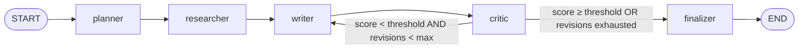

# Architecture — Proofline

Status: **linear flow built** (ADR-0012); **Measured Ops contract built** (C1,
ADR-0014); **supervisor and approval gate built** (C2, ADR-0016); **approval inbox
built** (C4, ADR-0017); **eval/guard node built** (C7, ADR-0018); **content agent and
same-thread revisions built** (C8, ADR-0019); **MCP tools and the execute node built**
(C5, ADR-0022); **kill switch, per-run budget, digests and Postgres logs built** (C10 parts,
ADR-0023). Sections 3–11
describe the content pipeline, which becomes the Measured Ops content agent
(ADR-0013). Section 13 describes Measured Ops itself: the contract, the agent
interface, the approval policy, the supervisor, its eval node, its gate, the tools and
executors, and the inbox. Planned parts
are marked ⟶ with the `docs/PLAN.md` step that brings them, so the design doesn't
need to be torn up when they land.

## 1. What it does

Input: a topic and an audience. Output: one short technical script (title, hook,
body, call to action; at most 140 words by default, about 56 s at 150 wpm) for a LinkedIn post and a
1-minute video, with inline citations, saved as Markdown + JSON.

A human is the final gate (the approval gate in C2, the inbox in C4). The machine's job is to get a draft good enough
that review is a 2-minute read, not a rewrite.

## 2. Three packages, one workspace

```
packages/
  proofline/        the content pipeline (LangGraph graph, nodes, CLI) and, since C8,
                    the content agent (`proofline.agent.ContentAgent`)
  measured_ops/     Measured Ops: contracts, agent interface, approval policy (C1);
                    supervisor + gate + checkpointer (C2); inbox (C4); eval node,
                    usage collection, price table (C7); MCP tools, executors and the
                    execute node (C5, `tools` extra)
  measured_evals/   eval + security layer: guard-v0 checks (quality, injection, PII)
                    and usage cost (C7); golden sets, judge metrics, budgets (GROW-14/15)
```

Dependencies point one way: **proofline → measured_ops → measured_evals**, never
back (ADR-0014; `proofline` depends on `measured_ops` since C8, and declares
`measured_evals` directly since the golden-set runner reads its golden sets). The
supervisor gets agents injected, so `measured_ops` never imports `proofline`
(`packages/measured_ops/tests/test_ops_boundary.py`). `measured_evals` is published
as open source at launch and reused by a separate web app (Measured Lab), so it
can't know anything about either: `packages/measured_evals/tests/test_boundary.py`
fails if it declares or imports `proofline` or `measured_ops`, and CI installs it
alone and runs its tests (ADR-0012).

## 3. Graph

Built (critic loop wired in C8):



There is no human review node in this graph: the supervisor's approval gate (C2)
and the inbox (C4) approve what the content agent proposes, and a rejection with
feedback comes back as a new `Task` (ADR-0014, §13).

Routing is a pure function in `routing.py` (already implemented and tested):

| Router | Reads | Returns |
|---|---|---|
| `route_after_critic` | `score`, `revision_count`, `run_config` | `"writer"` \| `"finalizer"` |

`revision_count` = number of writer passes **after** the first draft. Backstop:
every invocation passes `recursion_limit` (default 40).

`build_graph()` uses the full `ScriptState` as its input schema: a narrower input
schema would drop the defaults `initial_state()` sets for later-week fields.

## 4. State

`state.py` — `ScriptState(TypedDict, total=False)`. TypedDict for the graph,
Pydantic for every value (ADR-0002). `initial_state(topic, audience, run_config)`
sets every default.

| Field | Type | Written by | Default / notes |
|---|---|---|---|
| `topic`, `audience` | `str` | input | |
| `run_config` | `RunConfig` | input | settings snapshot (models, thresholds, `max_words`, `brand_name`) so a resumed run behaves like it started (ADR-0004) |
| `outline` | `Outline` | planner | angle, key questions, search queries, 2–4 beats |
| `research_notes` | `ResearchNotes` | researcher | sources with code-assigned ids `S1..Sn`, findings citing them, gaps |
| `draft` | `Draft` | writer | title/hook/body/CTA; cited ids, word count, duration derived from the text |
| `revision_count` | `int` | writer | 0 |
| `critique` | `Critique \| None` | critic (C8) | `None` |
| `score` | `float \| None` | critic (C8) | `None`; = `Critique.overall`, computed in Python |
| `feedback` | `str \| None` | input (optional) | `None`; a human's feedback, set when a rejected action comes back as a revision `Task` (ADR-0014) |
| `previous_preview` | `str \| None` | input (optional) | `None`; the rejected action's preview, from a revision `Task`: the writer revises from it when there's no `draft` yet (ADR-0019) |
| `final_script` | `FinalScript` | finalizer | rendered Markdown + metadata |
| `history` | `Annotated[list[RevisionRecord], operator.add]` | writer, critic | `[]`, append-only |

Rule: a node writes only the fields in its row (`state.FIELD_OWNERS`, checked by
`packages/proofline/tests/test_contracts.py`).

## 5. Node contracts

Every node: `async def node(state: ScriptState, runtime: Runtime[Deps]) -> dict`.

**planner** — reads `topic, audience, run_config`. One structured LLM call →
`Outline`. Prompt gets the brand name and word limit.

**researcher** — reads `topic, outline, run_config`. Calls
`deps.researcher.research(topic, outline, run_config)` (the `Researcher` port) and
then drops findings that cite unknown source ids, so every implementation gets that
guarantee (ADR-0007). Wired with `researcher.RETRY_POLICY` (3 attempts, retries only
`SearchUnavailableError`, ADR-0011). Implementations (`research/`):
- `StubResearcher` (default, `PROOFLINE_RESEARCHER=stub`): fixed, checked notes; no network.
  It reports the outline's key questions as gaps (it never researched them), and the CLI
  says research is stubbed.
- `WebResearcher` (`PROOFLINE_RESEARCHER=web`): runs the outline's queries concurrently
  through the `SearchClient` port (Tavily), dedupes by normalized URL, keeps the top
  `max_sources`, truncates, **assigns `S1..Sn` in code**, and makes one structured LLM
  call for findings. Sources reach the model inside escaped `<source>` tags, as
  untrusted data.
- `FixtureResearcher` (`proofline golden` only): a golden item's own fixture sources, ids
  kept as written, findings from the same `extract_findings` call as `WebResearcher`; an
  item with no sources gets empty notes and no call.
- ⟶ Content agent v1 (GROW-9): a web-search agent behind the same protocol; graph.py doesn't change.

**writer** — reads `outline, research_notes, run_config` (+ `draft, critique,
feedback` on revisions, from C8). Every factual claim cites a source id
inline (`[S3]`); citations live only in the text and are normalized, with unknown or
unparseable ones dropped and logged; titles carry no citations. Over `max_words` →
one more call (revision context kept) asking for a cut; the shorter draft is kept. Increments `revision_count` on revisions;
appends a `RevisionRecord(kind="draft")`.

**critic** (wired in C8) — scores against `docs/RUBRIC.md` (8 criteria,
integer 1–10, each with quoted evidence and a concrete fix). Writes `critique` and
`score`. `Critique.overall` is a weighted mean computed in Python with a **hard
gate**: `technical_accuracy < 6` caps it at 6. Validation requires each criterion
exactly once, so a malformed critique goes through the adapter's repair retry.

**finalizer** — deterministic, no LLM. Renders title, hook, body, call to action
and the cited sources as Markdown; writes `outputs/<thread_id>/script.md` and
`script.json` (overwrite, so retries are idempotent). `final_score` is `None` until
the critic runs.

## 6. Dependencies (runtime context)

`context.py`: `Deps(settings, llm: StructuredLLM, researcher: Researcher)`, passed as
`graph.ainvoke(..., context=deps)`. Nodes read `runtime.context`; nothing imports a
client at module level (ADR-0003). Tests build `Deps` with `FakeLLM`, and with
`StubResearcher` or a `WebResearcher` over `FakeSearch`.

`StructuredLLM.generate(prompt, schema, *, role, run_config) -> T`: one method.
`build_llm(settings)` picks the adapter from `PROOFLINE_LLM_PROVIDER` (only
`anthropic` today; an unknown provider or missing key fails before the run starts).
The Anthropic adapter maps `role` to the model and token limit from `RunConfig` (no
temperature by default, ADR-0015),
uses `with_structured_output(..., method="json_schema")`, retries once with the
validation error, and tags each call with the prompt name and version.

## 7. Configuration

All from environment / `.env` (`config.Settings`, prefix `PROOFLINE_`), snapshotted
into `RunConfig` at run start: brand name, word limit, researcher choice, model
provider and per-role models, thresholds. See `.env.example`.

## 8. Persistence

The supervisor uses its own factory, `measured_ops.checkpoint.open_checkpointer(url)`
(section 13). The content pipeline's: `checkpointing.open_checkpointer(url)`: `memory://` → `InMemorySaver`,
`sqlite:///…` → `AsyncSqliteSaver`, `postgresql://…` → `AsyncPostgresSaver`. All
use a `JsonPlusSerializer` whose `allowed_msgpack_modules` lists every state model
(ADR-0006). `thread_id` = run id (UUID4). The CLI runs the pipeline without a checkpointer.

## 9. Interfaces

**CLI** (`cli.py`, Typer):
- `proofline golden --out outputs/golden/<run> [--item ID] [--all] [--overwrite]`
  (`golden.py`, GROW-14): the full pipeline on each approved golden item, with
  `research/fixture.py`'s `FixtureResearcher` (the item's own sources, ids kept as written,
  findings from the same `extract_findings` step `WebResearcher` uses; no search). Saves
  `<item-id>.md` (title, hook, body, call to action; no Sources list) and
  `critic_scores.json`, under `outputs/` only; skips items already saved; a failed item
  is reported and the rest run. `measured_evals run --outputs` checks the files.
- `proofline propose --topic … --audience …` (C8) runs the supervisor with the content
  agent against the inbox's database (`MEASURED_OPS_INBOX_CHECKPOINTER_URL`), masked
  tracing on, and prints the run's id once the draft waits at the gate; a failed draft
  exits 1 with the agent's error. `proofline inbox` serves the inbox with the content
  agent (`measured_ops.inbox.server.serve`).
- `proofline run --topic … --audience … [-v]` runs the graph and prints the Markdown
  script (stdout); file paths go to stderr.
- `proofline mermaid` prints the graph.
- No review prompt: approval happens in the supervisor's gate and inbox (ADR-0014).

**API** (`api.py`): `create_app(deps=..., checkpointer_url=...)` serves only
`GET /health` → `{status, checkpointer}`. The run and review endpoints planned here
were dropped (ADR-0014); the approval inbox is the human interface and lives in
`measured_ops.inbox` (C4, ADR-0017; section 13).

## 10. Observability

Every invocation sets `run_name="script-pipeline"`, `tags=[env]`,
`metadata={thread_id, prompt_versions, models}`; each LLM call is tagged with its
prompt name/version. Logging: stdlib `logging`, `proofline.*` loggers, one INFO line
per node (`proofline run -v`). Per agent (C7, section 13): each agent run is named
`agent:<name>` with that tag and `{agent, task_id}` metadata, so LangSmith groups it;
its tokens per model (cache reads and writes apart) land in `OpsState.usage` and the
inbox prices them. ⟶ GROW-15: cost budgets and alerts via `measured_evals`.

## 11. Failure behavior

| Failure | Behavior |
|---|---|
| Invalid setting / unknown provider / missing API key | CLI prints the error (no traceback) and exits 1, before any call |
| Search timeout / 5xx / network (all queries) | `SearchUnavailableError` → RetryPolicy (3 attempts, backoff); then fails loudly |
| Search auth / quota / bad request | not retried; fails immediately |
| Search returns nothing usable | notes with `gaps` = the key questions; the writer says what's unclear |
| LLM returns invalid structure | adapter retries once with the validation error; then raises |
| LLM cites an unknown source id | dropped in code (findings and drafts), logged at WARNING |
| Draft over the word limit | one cut requested; the shorter draft is kept (the critic, wired in C8, scores length) |

## 12. Security baseline

- Web content is data, never instructions: escaped inside `<source>` and
  `<research_notes>` tags, with an explicit rule in every prompt that sees it; no
  tools in the linear flow, so injected instructions have nothing to act on.
- Tools (C5, ADR-0022): agents hold read ports only; writes run only in the supervisor's
  executors, after the policy (and the gate, where it asks). An executable action's
  preview and target are rendered from its params and re-checked, so what's approved is
  what runs; Jira projects and calendars outside the config are never read or changed.
  No secret is written in a tools config: servers get credentials from env vars it names.
  Tool results are untrusted data (ADR-0021's inbound screen isn't wired to them yet).
- Secrets only from env; `.env` is unreadable to Claude Code (hooks + deny rules).
- Nothing private in this public repo, checked twice (C0): `.pre-commit-config.yaml`
  runs gitleaks and `scripts/pii_scan.py` (emails, phone numbers, SINs) on every
  commit, and CI runs gitleaks over the full history plus the PII scan over every
  tracked file except `uv.lock` and the scanner's own fixtures.
- Every action an agent proposes is checked by the eval node before the policy sees
  it (C7, ADR-0018): structure, instruction-like text, PII. A failed check only adds a
  human approval. Check reasons name the kind of problem, never the matched value, so
  personal data stays out of scores, logs and the inbox's check rows; the preview
  itself is shown as the agent wrote it (the human approves what they see). Logs name
  actions by id and type, never the target.
- Traces: `measured_ops.tracing.masked_tracing_callbacks()` returns a LangSmith tracer
  whose client redacts emails, phone numbers, SINs and card numbers
  (`measured_evals.checks.redact_pii`) in every input, output and error; it replaces
  LangChain's env tracer. Every process that starts or resumes a supervisor run passes
  it as `callbacks`: the inbox (resumes and revisions), `seed`, `proofline run` and
  `proofline propose` do (C8). The content agent's nested pipeline passes no
  `callbacks`, so it inherits the supervisor's masked tracer.
- ⟶ GROW-14/15 (`measured_evals`): judge metrics, prompt-injection suite, cost
  budgets; API auth and rate limiting in the app.

## 13. Measured Ops (`packages/measured_ops`, C1 contract; ADR-0014)

```
Task ──agent subgraph──▶ AgentResult(actions=[PendingAction, ...])
                               │
               policy.decide(action) ── "auto" ──▶ ready ──▶ execute ──▶ ActionOutcome (C5)
                               │      └── "never" ──▶ blocked + logged, no inbox
                           "approval" ──▶ gate ──▶ ApprovalDecision ──▶ ready | rejected
                                                       │        (C2 gate, C4 inbox)
                                 rejected + feedback ──▶ new Task(feedback, parent_id)  (C8)
```

**Contract** (`contracts.py`). Frozen Pydantic models, unknown fields rejected:

| Model | Fields | Rules |
|---|---|---|
| `Task` | `id`, `agent`, `goal`, `inputs` (JSON), `feedback`, `parent_id`, `created_at` | `agent` is snake_case; `feedback` needs a `parent_id` (a revision) |
| `PendingAction` | `id`, `task_id`, `type`, `target`, `preview`, `params` (C5), `eval_scores`, `risk_level`, `created_at` | `type` is a policy key (snake_case); `risk_level` ∈ low/medium/high; `eval_scores` written only by the eval node (C7, ADR-0018), never by the agent; `params` (JSON, default empty) are an executable action's arguments, and its `target` and `preview` must be the ones they render to (C5, ADR-0022) |
| `AgentResult` | `task_id`, `agent`, `status`, `summary`, `actions`, `error`, `finished_at` | failed ⇔ `error`; failed proposes no actions; every action belongs to this task; action ids unique |
| `ApprovalDecision` | `action_id`, `approved`, `feedback`, `decided_at` | the gate's resume value |
| `ActionOutcome` | `action_id`, `type`, `status`, `key`, `detail`, `ref`, `finished_at` | C5: one per ready action, written only by `execute`; `status` ∈ applied / already_applied / manual; `key` = the change's identity hash; `ref` = the external id touched |

`OpsState` (TypedDict, ADR-0002): `task`; `results`, `decisions`, `blocked`,
`ready`, `executed` (C5) and `usage` (C7) with `operator.add` reducers; `evaluated_actions` (C7, no
reducer, one writer: `evaluate`); `pending_actions` (no reducer: `triage` sets
it, `gate` pops it, which is fine while one agent runs at a time; ADR-0016).
Every proposed action ends in exactly one of `ready`, `blocked`, or rejected (its
decision in `decisions`), and every `ready` action gets exactly one `ActionOutcome` (C5).
`initial_ops_state(task)` sets every field. `contracts.SERDE_ALLOWLIST` is built
from `STATE_TYPES` and must be passed to the supervisor's checkpointer (ADR-0006).

**Agent interface** (`agent.py`). An agent has a `name` and `build()` → a compiled
`StateGraph(PrivateState, input_schema=AgentInput, output_schema=AgentOutput)`:
input `{"task": Task}`, output `{"result": AgentResult}`, private state hidden.
`check_agent_graph(graph)` rejects other input/output keys; `run_agent(agent,
graph, task)` invokes it and rejects a result for another task or agent, or one
whose actions carry eval scores (agents never score themselves). Agents
propose actions; they never execute anything that leaves the system.

**Approval policy** (`policy.py`). A TOML table, `version = 1`, `[actions]` rows of
`"auto"`, `"approval"` or `"never"`. `load_policy()` reads the public demo table
bundled at `measured_ops/config/approval_policy.demo.toml` (rows from GROW-69, plus
`bulk_export_personal_data` and `act_outside_own_systems` as `"never"`, and
`approve_draft` as `"approval"` since C8; since C5 `schedule_calendar_block` as
`"approval"` (C3) in place of `schedule_internal_block`, and `triage_ticket` stays `"auto"`);
`load_policy(path)` reads the private one. `decide(action)`:

1. row is `"never"` → **never**: blocked, logged at WARNING (id, type, task; never the
   target), recorded in
   `OpsState.blocked`, never sent to the inbox (risk level and scores can't change this);
2. `risk_level="high"` → approval;
3. an "auto" row with **missing or failed `eval_scores` → approval** (C7, fail
   closed; logged with metric names only);
4. listed type → its row; **unlisted type → approval**.

A failed eval can only raise "auto" to approval; a test checks every row × risk ×
eval combination.

`check_decision(action, decision)` raises `ActionBlockedError` if a human approval
targets a blocked action; the gate (C2) and inbox (C4) call it before acting.

**Evals** (`measured_evals.evaluate(output, context) -> EvalScores`, async). Plain
text and a plain mapping in, so the package knows no app types. `EvalScores`:
scores in [0, 1], a threshold, the evaluator name, and `reasons` (a few words per
failing metric, never the matched text); `passed` is computed (every score ≥
threshold, and at least one score). Since C7 it runs guard-v0 (`checks.py`, ADR-0018),
deterministic, each check 0 or 1:
- `quality`: not empty, within `context["max_words"]`, no placeholders, at least one
  `[S1]`-style citation if `context["require_citations"]`;
- `injection`: override phrases, role/system tags (incl. a stray `</source>`),
  invisible or bidi characters, links with query parameters;
- `pii`: emails, phone numbers, SINs and card numbers (Luhn); fictional values count;
  `context["pii_allow"]` lists exact addresses or numbers that may appear.
A check that raises propagates. Judge metrics ⟶ GROW-14, injection suite ⟶ GROW-15.

**Usage and cost** (`measured_evals.cost`, `measured_ops.usage`, `measured_ops.prices`).
`Usage(agent, model, input_tokens, output_tokens, cache_read_tokens,
cache_write_5m_tokens, cache_write_1h_tokens, calls=1)`: `input_tokens` is uncached
input only; `prompt_tokens` is all input (uncached + cache reads + writes).
`cost(usage, prices)` per million tokens; a model missing from the table → `None`
("unknown"), never 0. A `long_context` tier (Haiku 5.5: prompt over 100,000 tokens,
cache included) applies per call from that call's `prompt_tokens`; a multi-call total
on a tiered model → `None`, never under-priced. `collect_usage(agent)` puts a callback handler in a context
variable that LangChain adds to every callback manager configured inside, so it sees
every chat model call in the agent's subgraph without replacing the run's other
callbacks. It converts langchain-anthropic's `usage_metadata` (whose `input_tokens`
includes cache tokens; cache writes split `ephemeral_5m/1h`, or unsplit
`cache_creation` = 5 minutes) and records one `Usage` per call (`calls()`), so tiered
prices stay per call. A call without a model name counts
as `unknown`. Nested blocks: only the innermost counts a call. Model calls made
outside LangChain aren't seen. Prices match the exact model id the response reports. Demo prices: `measured_ops/config/model_prices.demo.toml`;
`load_model_prices(path)` reads a private table.

**Supervisor** (`supervisor.py`, ADR-0016). `build_supervisor(agents, policy)`
returns the uncompiled `StateGraph`; compile it with a checkpointer.

```
START → call_agent → evaluate → triage ─┬→ execute ⟲            (C5: one ready action per step)
           ▲                            ├→ gate ─┬→ execute     (just approved)
           │                            │        ├→ gate        (more pending)
           │                            │        ├→ revise ─┐   (rejected with feedback, revision < max)
           └────────────────────────────┼────────┼──────────┘
                                        └────────┴→ END         (execute routes like gate)
```
`route_pending` (pure, after triage): "execute" while a `ready` action has no outcome
(C5), else "gate" while `pending_actions` is non-empty, else END. `route_after_gate`
(pure, C8; after `gate` and `execute`): an unexecuted ready action → execute; more
pending → gate; else this round has a
rejection with feedback and the task's `revision` (`Task.inputs["revision"]`, 0 when
absent) is below `max_revisions` (default 3) → revise; else END. An invalid revision
number fails closed (END, logged).

- `build_supervisor` builds and checks every agent's graph at startup; duplicate
  names fail. `call_agent` runs the task through `run_agent` inside `collect_usage`,
  with `agent_run_config` (run name, tag, metadata; no `callbacks` key, which would
  replace the parent's), and appends the result and its usage; an unknown agent fails
  loudly. If the agent raises, its token totals are logged at WARNING before the error
  propagates (the state update, and so `usage`, is lost).
- `evaluate` (C7, ADR-0018) scores each action of the latest result with the injected
  `evaluator` (default `measured_evals.evaluate`) and the supervisor's `eval_context`,
  plus its `target` with the injection and PII checks (metrics `target_injection`,
  `target_pii`), and writes the scored copies to `evaluated_actions`. The agent's own result stays
  unscored. It logs pass/fail with metric names only. It refuses a result with more than 10
  actions, or with an action id seen in an earlier result or decision (ids key decisions and
  outcomes). First (C5) it re-checks every
  executable action (`tools.specs.SPECS`): params valid, target and preview equal to what
  they render, in the configured scope, with an executor configured; otherwise it raises
  `AgentContractError` and nothing reaches triage.
- `triage` calls `policy.decide` once per scored action (never in the gate, which re-runs on
  resume): auto → `ready`, never → `blocked`, approval → `pending_actions`.
- `gate` pauses on the head of `pending_actions` with `interrupt(payload)`, where the
  payload is `action_id`, `task_id`, `type`, `target`, `preview`, `risk_level` and
  `eval` (`evaluator`, `passed`, `failing`, `scores`, `reasons`; C7).
  The resume value is `ApprovalDecision.model_dump()`. It is validated **inside**
  `interrupt(response_schema=answer_schema(action, policy))`: it must be for the
  waiting action, and `check_decision` runs. A bad answer raises to the caller
  (`ValidationError`, or `ActionBlockedError`, which `is_invalid_resume` doesn't
  mark: catch both), nothing is bound to the gate task, and the run stays paused
  for a new `Command(resume=...)`. A refused **unkeyed** answer (`Command(resume=value)`)
  stays as the pending resume until then, and a bare `ainvoke(None)` replays it; a
  refused answer **keyed by interrupt id** leaves nothing, and `ainvoke(None)` just
  pauses again, undecided (ADR-0016 amendment). Either way, never retry with a bare
  `ainvoke(None)`. (Raising after
  `interrupt()` returns would bind the bad answer and replay it on every resume.) An approved action goes
  to `ready`; a rejection is recorded.
- `revise` (C8, ADR-0019) builds the next `Task` for the same agent: `parent_id` = the
  task it revises, the round's feedback (joined, capped at 4,000 characters), and
  `inputs` + `previous_preview` (the rejected previews, joined with `---`) +
  `revision` (+1). It writes `task` and the graph returns to `call_agent`; no interrupt
  and no I/O, so it runs once per pass, and the gate is unchanged. A rejection without
  feedback, or past the cap, ends the run.
- `execute` (C5, ADR-0022; `RetryPolicy` on `ToolUnavailableError`, 3 attempts) runs the
  first `ready` action without an outcome through `tools.executors.execute_action` and
  appends its `ActionOutcome`; one action per step, so each side effect is checkpointed
  before the next. `build_supervisor(..., executors=...)` passes them in. Types without a
  spec get "manual" (`approve_draft` never has an executor, ADR-0019); an executable type
  without its executor, or a failed call, raises and stops the run at `execute` with the
  decision saved; `ainvoke(None)` continues it (no interrupt pending there).

**Tools** (`tools/`, C5, ADR-0022; MCP adapters need the `tools` extra, `mcp>=2.3,<3`).
- `specs.py` (pure): `triage_ticket` (`TriageParams`: issue, to_status, add/remove labels,
  priority, reason) and `schedule_calendar_block` (`BlockParams`: calendar alias, title,
  aware start/end ≤ 12 h, description). Each renders `target` (`jira:DEMO-1`,
  `calendar:personal`) and `preview` from its params, gives an identity key (the change
  without the explanation) and checks scope (`ToolScope`: Jira projects, calendar aliases).
  Agents propose with `spec.propose(task_id, params)`.
- `ports.py`: read ports for agents (`JiraReads.search/get_issue/transitions`,
  `CalendarReads.list_events`) and write ports only executors hold (`JiraWrites.transition/
  update`, `CalendarWrites.create_event`).
- `executors.py`: `TriageExecutor` reads the issue, writes only what differs (a transition
  found by target status, then labels/priority), re-reads and raises if it didn't take;
  `CalendarBlockExecutor` creates the block unless an event with the same title, start
  and end is there. `Executors(executors, scope)` refuses an executor for `approve_draft`;
  `run` re-checks the action; a change already in place (a revision re-proposing an
  approved action, a retry after a crash) is found by reading and recorded
  "already_applied". An earlier outcome is never taken as proof.
- `config.py`: `ToolsConfig` from TOML (`load_tools_config(path)`; the bundled demo when
  no path; `MEASURED_OPS_TOOLS_CONFIG`): servers (stdio with `env_from`, or https with
  `headers_from_env`: env var names, never values) and, per logical operation, the tool,
  argument names (dotted = nested), constants and result paths. A tool can't be both read
  and write.
- `mcp.py`: `McpToolClient(name, server, allowed)` opens a session per call (`mcp.Client`:
  stdio, streamable HTTP, or an in-process `MCPServer` in tests) under one deadline (twice
  the server's `timeout_s`), refuses tools outside its allowlist, and maps failures to `ToolUnavailableError` (retried) / `ToolError` /
  `ToolConfigError`. `build_read_tools(config)` → read ports for agents (read allowlist);
  `build_executors(config)` → executors (read + write clients). Jira search results
  outside the configured projects are dropped.
- `demo_servers.py`: demo tracker and calendar MCP servers over one JSON file
  (`MEASURED_OPS_DEMO_TOOLS_STATE`, default `.data/demo_tools.json`), used by the demo
  config and the tests. `python -m measured_ops.tools check|list` verifies a config
  against the servers' `tools/list`, calling no tool.
- e2e (`tests/test_tools_e2e.py`): an agent reads the demo tracker over stdio MCP,
  proposes a move, the run pauses in another process, approval applies it (and a
  rejection doesn't; "auto" applies without pausing), on SQLite and Postgres.

**Staging pieces** (C10, ADR-0023).
- Kill switch (`killswitch.py`): a file (`MEASURED_OPS_KILL_SWITCH_PATH`, absolute;
  default `~/.measured_ops/kill_switch`, the same from every working directory).
  `build_supervisor(..., kill_switch=...)` defaults to `KillSwitch.from_env()`.
  `call_agent` raises `KillSwitchEngaged` before any agent runs, and `execute` before any
  executable action (writes stop too; a "manual" outcome isn't stopped); the run is
  resumable after release and the action then runs once. The inbox refuses Retry, skips
  its start-up sweep and says the switch is on; `proofline golden` starts no item.
- Budget (`budget.py`): `build_supervisor(..., budget=...)` defaults to the table
  `MEASURED_OPS_BUDGET_PATH` names (`budget=None` opts out; unset = no caps), priced with
  `MEASURED_OPS_PRICES_PATH` or the demo table. It checks the run's `usage` before each
  agent run and, through a `raise_error` callback set in a context variable, before every
  model call inside it (`guard_budget`). The calls cap counts the call about to be made;
  tokens and cost use spend so far; unknown cost fails closed, and a call that reports no
  usage counts as one call on the "unknown" model. Crossing a cap ends the run with a
  failed `AgentResult` (`error = "budget: ..."`) and that pass's usage recorded, so a
  resume can't spend more. Demo table `config/budget.demo.toml` (placeholder values).
- Digest (`digest.py`): `build_digest(inbox, prices=, kill_switch=)` → Markdown from the
  inbox service (waiting, stopped, in progress, drafts not posted, cost of runs active in
  the window, kill switch); no targets. `FileDigestSink(dir)` writes it.
- Worker (`worker.py`, `python -m measured_ops.worker`): `digest`, `run` (07:00 and
  21:00 America/Toronto by default, per-day local times, lock file), `kill`, `release`,
  `status`, `import-logs`. Runs no agent.
- Postgres logs (`pg_logs.py`): `PostgresJudgeLog`, `PostgresPostedLog` behind the same
  ports, chosen by `MEASURED_OPS_LOGS_URL` in `judge_log_from_env` / `posted_log_from_env`;
  tables created on first use (nothing connects at construction); `import_jsonl` is
  idempotent; callers on an event loop run them in a worker thread.

**Checkpointer** (`checkpoint.py`). `open_checkpointer(url)`: `memory://`,
`sqlite:///path`, `postgresql://…` (needs the `postgres` extra; a small connection pool
that survives a database restart; runs `setup()` on open), always with `SERDE_ALLOWLIST`. Supabase is plain Postgres here (hosted run ⟶ C10).

**Stub agent** (`echo.py`). `EchoAgent` drafts the task's goal and proposes one
`publish_public` action (or another type, `EchoAgent("draft_content")`, for the C7 cases). It exists for the e2e test and is injected like any agent.

**e2e** (`tests/test_ops_e2e.py`). Task → echo agent → pause in a child process
(`ops_e2e_child.py`) → resume in the test process from the checkpoint → done.
Approve and reject cases, SQLite and Postgres, strict msgpack. C7 adds: a failed
check pauses an "auto" action across the restart; a clean one runs without pausing. The Postgres case
needs `MEASURED_OPS_TEST_DATABASE_URL`: it skips locally without it and fails in
CI, which runs a Postgres service container. Every later step keeps this green and
adds its own case.

**Approval inbox** (`inbox/`, C4, ADR-0017). Optional `inbox` extra.
- `service.Inbox(graph, policy, prices=...)`: `list_pending()` finds threads from
  `checkpointer.alist(None)` and keeps those paused at `gate`; each `PendingItem` carries
  the interrupt id, the payload and its `response_schema`, the checks from the
  payload's `eval` block (`None` for a run paused before C7) and tokens and cost per
  agent from `OpsState.usage` (C7; `None`, shown "Not tracked", when the run predates it). An action the policy has
  since tightened to "never" is listed `blocked_by_policy` (reject only), not hidden.
  `decide()` re-reads the thread, refuses an answer for an interrupt no longer pending
  (`AlreadyDecided`: the double-tap guard), and resumes with
  `Command(resume={interrupt_id: decision})`, never `ainvoke(None)`. A refused answer
  (`Refused`) leaves the run paused. A per-thread lock serialises simultaneous taps.
- `web.create_inbox_app(settings, agents, policy, prices=..., eval_context=...)`: FastAPI, Jinja2 autoescaped pages,
  one first-party script since C8 (ADR-0020). Sign-in: one passphrase checked against a scrypt hash, one attempt at a
  time, 5 failures lock it for 15 minutes; session cookie `__Host-mo_inbox`
  (`HttpOnly`/`Secure`/`SameSite=Strict`) whose server-side session id ends 12 hours after
  sign-in and is revoked on sign-out; size-limited forms; CSRF token on every POST;
  strict CSP. A thread that can't be read is logged and skipped. The detail page lists
  each check (passed or failed, with its reason) and the run's cost; the list marks
  "Check failed" and "Not evaluated". Settings from
  `MEASURED_OPS_INBOX_*` env vars, no secret defaults: it refuses to start without them.
- Background revisions (C8, ADR-0019): `decide` commits the gate step first
  (`interrupt_after=["gate"]`: saved, and refused answers still fail at once), logs the
  decision, then continues: next `revise` → a background task (`Outcome.revising`), next
  `gate` → synchronously (it pauses at once); a semaphore runs one at a time, each under
  `MEASURED_OPS_INBOX_REVISION_TIMEOUT_S` (default 600). `in_progress()` lists runs
  not waiting: running, queued, stopped (cut off here; after a gate step; between nodes
  on a revision task; or a first pass older than twice the timeout) and elsewhere (a fresh first pass: maybe
  `proofline propose` in another process). Agent runs never checkpoint
  (`checkpointer=False`), so a cut-off run restarts its agent from the start. `retry()` continues a
  stopped run with `ainvoke(None)` (safe: no interrupt pending); the lifespan calls
  `start()` (continue each stopped run once) and `aclose()` (cancel; they continue
  next start). `POST /r/{thread_id}/retry` (CSRF) is the Retry button. C10 moves this
  to a worker with budget caps.
- Judge log (C8, ADR-0019): after a decision is accepted, the inbox appends
  `{"kind": "decision", "action_id", "eval", "approved"}` to `measured_ops.judge_log`
  (`MEASURED_OPS_JUDGE_LOG_PATH`, default `.data/judge_log.jsonl`); the content agent
  appends `{"kind": "critic", "action_id", "critic"}` when it proposes. Ids, scores and a
  bool only: the port has no parameter for text. GROW-13 joins them on `action_id`.
- Ready to paste (C8, ADR-0020): `GET /ready` lists approved `approve_draft` actions
  (`list_ready`: from each thread's `ready` and approving decisions, newest first), each
  preview split on its `## ` headings into read-only blocks with a Copy button.
  `POST /ready/{action_id}/posted` (CSRF) appends `{"action_id", "posted_at"}` to
  `measured_ops.posted` (`MEASURED_OPS_POSTED_PATH`, default `.data/posted.jsonl`) and
  hides it; it never resumes or writes to a run. `proofline ready [--out]` prints the
  same list. The decision form is explicit: Approve, Revise with this feedback (needs
  text and a revision left; shows "Revision 2 of 3"), Reject and stop (drops any text).
  The inbox's one script, `/static/inbox.js` (CSP `script-src 'self'`), copies blocks
  and disables Revise while the box is empty; pages work without it.
- Approved actions run in `decide` (C5, ADR-0022): after committing the gate step it
  continues with `ainvoke(None, interrupt_before=["revise"])` (no interrupt pending), so
  `execute` runs in the request and a revision still goes to the background. `Outcome`
  carries what ran (`executed`) or `failed`; a failure keeps the decision, marks the run
  "Stopped" and the page says so; Retry continues it. A run waiting to execute an action a
  human approved is "stopped" at once after a restart. The continuation runs under
  `MEASURED_OPS_INBOX_EXECUTE_TIMEOUT_S` (default 120); a timeout or the kill switch also
  leaves the decision saved and the run "Stopped". Log writes (judge log, posted marks)
  run in a worker thread. `create_inbox_app(...,
  executors=...)`; `serve` builds them from `MEASURED_OPS_TOOLS_CONFIG`.
- One process: the lifespan holds an exclusive lock file. `python -m measured_ops.inbox
  serve` binds 127.0.0.1 with one worker; the phone reaches it over `tailscale serve`
  (`docs/INBOX.md`). Edit is deferred to C9.
- e2e (`tests/test_inbox_e2e.py`): pause in another process → sign in → approve or
  reject over HTTP → the thread finishes, on SQLite and Postgres.


**Content agent** (`proofline/agent.py`, C8, ADR-0019). `ContentAgent(deps)`, name
`content`: a one-node agent subgraph that reads `Task.inputs` (`topic`, `audience`;
bad inputs give a failed `AgentResult` with the reason), runs the pipeline graph
(planner → researcher → writer ⇄ critic → finalizer) nested in the supervisor's thread
(no `configurable`, no `callbacks`: it inherits both), and proposes one
`approve_draft` action, target `manual paste: linkedin`, whose preview is
`render.approve_draft_preview`: the LinkedIn post, the clip script (citation marks
removed, estimated length) and the lesson outline from the planner's outline. Approving
it only moves it to `ready`: no executor is ever registered for `approve_draft`. The
critic's score stays inside the agent (in the summary), never `eval_scores`.

## 14. Docs

`docs/PLAN.md` (ordered steps), `docs/adr/` (decisions), `docs/PROMPTING.md` (prompt
standards), `docs/RUBRIC.md` (critic rubric), `docs/BRAND_VOICE.md` (voice, owned by
the host; the brand name itself is `PROOFLINE_BRAND_NAME`).
