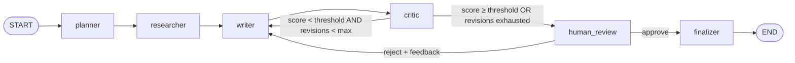

# Architecture — Proofline

Status: **Phase 1 design** (LangGraph fundamentals). Extension points for
Phase 2/3 are marked ⟶ so the design doesn't need to be torn up later.

## 1. What it does

Input: a topic, an audience, a format (`short` ≈ 60 s, `long` ≈ 8–12 min).
Output: an approved, sourced video script for Build Clearly, saved as Markdown
+ JSON, with the full revision history in the checkpoint.

A human (Hassan) is the final gate. The machine's job is to get a draft good
enough that review is a 2-minute read, not a rewrite.

## 2. Graph

Routing is two pure functions in `routing.py`:

| Router | Reads | Returns |
|---|---|---|
| `route_after_critic` | `critique.overall`, `revision_count`, `run_config` | `"writer"` \| `"human_review"` |
| `route_after_human` | `approved` | `"writer"` \| `"finalizer"` |

`revision_count` = number of writer passes **after** the first draft. With
`max_revisions=3` the critic loop produces at most 4 drafts before a human sees
it. A human rejection always gets a rewrite (the human is the loop guard); the
critic still scores that rewrite, and if the budget is spent it goes straight
back to review with the critique attached.

Backstop: every invocation passes `recursion_limit=40`.

## 3. State

`state.py` — `ScriptState(TypedDict, total=False)`. TypedDict for the graph,
Pydantic for every value that came from an LLM (ADR-0002).

| Field | Type | Written by | Notes |
|---|---|---|---|
| `topic` | `str` | input | |
| `audience` | `str` | input | |
| `video_format` | `"short" \| "long"` | input | |
| `run_config` | `RunConfig` | input (from Settings) | snapshot of thresholds/models so a resumed run behaves like it started (ADR-0004) |
| `plan` | `Plan` | planner | angle, key questions, search queries, outline, target duration |
| `research_notes` | `ResearchNotes` | researcher | sources with code-assigned ids `S1..Sn`, findings citing those ids, gaps |
| `draft` | `Draft` | writer | structured script; cited ids, word count + duration derived from the narration (ADR-0011) |
| `revision_count` | `int` | writer | 0 on first draft |
| `critique` | `Critique` | critic | per-criterion scores + evidence; `overall` computed in Python |
| `approved` | `bool` | human_review | |
| `feedback` | `str \| None` | human_review | free text from the reviewer |
| `final_script` | `FinalScript` | finalizer | rendered markdown + metadata |
| `history` | `Annotated[list[RevisionRecord], operator.add]` | writer, critic, human_review | append-only audit trail |

Rule: a node writes only the fields in its row. Enforced by review and by
contract tests in `tests/test_contracts.py`.

## 4. Node contracts

Every node: `async def node(state: ScriptState, runtime: Runtime[Deps]) -> dict`.

**planner** — reads `topic, audience, video_format`. One structured LLM call →
`Plan` (3–5 search queries, 3–6 outline sections). `target_seconds` is set in
code from the format, overriding the model (ADR-0011). No network besides the LLM.

**researcher** — reads `plan`. Runs `plan.search_queries` concurrently against
`deps.search` (semaphore = 4), dedupes by normalized URL, keeps the top
`max_sources`, truncates each to `max_source_chars`. **Ids `S1..Sn` are assigned
in code.** One structured LLM call extracts `findings` that must cite those ids;
unknown ids are dropped and logged. Sources are passed to the LLM inside
`<source id="S3" url="...">` tags and treated as untrusted data (ADR-0007).
`researcher.RETRY_POLICY` on this node: 3 attempts, retrying only
`SearchUnavailableError` (timeouts, transport errors, 5xx). One failed query
doesn't fail the node; all failing does (ADR-0011).
⟶ Phase 2: this node becomes a supervisor + parallel specialist researchers
(web, docs/GitHub, dev discussions). The `ResearchNotes` contract stays the same,
so writer/critic don't change.

**writer** — reads `plan, research_notes, draft?, critique?, approved?, feedback?`.
First pass: write from plan + notes. Revision: fix the critique's `must_fix`
items first; if the last human decision was a reject, the human feedback
outranks the critique. Every factual claim must cite a source id inline (`[S3]`);
citations live only in the narration (`Draft.cited_source_ids` is parsed from it),
and inline citations to unknown ids are stripped and logged. Increments
`revision_count` on revisions. Appends a `RevisionRecord(kind="draft")`.

**critic** — reads `draft, research_notes, plan, audience`. Scores against
`docs/RUBRIC.md` (8 criteria, integer 1–10, each with quoted evidence from the
draft and a concrete fix). `Critique.overall` is a weighted mean computed in
Python with a **hard gate**: if `technical_accuracy < 6`, overall is capped at 6.
`Critique` validation requires each criterion exactly once, so a malformed critique
goes through the adapter's repair retry (ADR-0011). Low temperature. ⟶ Phase 2: an independent fact-checker agent runs before or
beside the critic, possibly on a different model.

**human_review** — calls `interrupt(payload)` with title, rendered draft, score,
critique summary. Resume value: `HumanDecision{approved, feedback}`. **No side
effects before `interrupt()`** — the node re-executes on resume (ADR-0005).

**finalizer** — reads `draft, research_notes, critique, revision_count,
run_config`. Deterministic (no LLM): renders Markdown with a sources section,
writes `outputs/<thread_id>/script.md` and `script.json` (idempotent overwrite),
returns `FinalScript`.
(A repurposing team fanning out from here is deliberately cut until after
the Jan 2027 launch.)

## 5. Dependencies (runtime context)

`context.py` defines `Deps` (dataclass): `settings`, `llm: StructuredLLM`,
`search: SearchClient`. Passed as `graph.ainvoke(..., context=deps)`.
Nodes read `runtime.context`. Tests pass `FakeLLM` / `FakeSearch`. Nothing
imports a client at module level (ADR-0003).

`StructuredLLM.generate(prompt: RenderedPrompt, schema: type[T], *, role: ModelRole) -> T`
— one method. The Anthropic adapter maps `role` (`planner|researcher|writer|critic`)
to the model + temperature from `RunConfig`, uses
`with_structured_output(..., method="json_schema")` (ADR-0011), and tags the call
with the prompt name + version for tracing.

## 6. Persistence

`checkpointing.py` → `open_checkpointer(url)` async context manager:
- `memory://` → `InMemorySaver` (tests, notebooks)
- `sqlite:///.data/checkpoints.db` → `AsyncSqliteSaver` (local dev, Week 3)
- `postgresql://...` → `AsyncPostgresSaver` (Supabase, end of Week 3 stretch / Phase 2)

All three use a `JsonPlusSerializer` with `allowed_msgpack_modules` listing every
Pydantic model that lives in state (ADR-0006). `thread_id` = run id (UUID4).

## 7. Interfaces

**CLI** (`cli.py`, Typer): `proofline run TOPIC --audience --format` runs to
the interrupt, prints the draft + critique, prompts approve/reject in the
terminal, resumes. `proofline show THREAD_ID`, `proofline mermaid`.

**API** (`api.py`, Week 3) — `create_app(deps=..., checkpointer_url=...)`; tests inject fakes + `memory://`:

| Method | Path | Body | Returns |
|---|---|---|---|
| POST | `/runs` | `StartRunRequest{topic, audience, video_format}` | `RunView` (runs to the first interrupt) |
| GET | `/runs/{thread_id}` | — | `RunView` from the latest checkpoint |
| POST | `/runs/{thread_id}/review` | `HumanDecision` | `RunView` (next interrupt or completed) |
| GET | `/health` | — | `{status, checkpointer}` |

`RunView{thread_id, status: awaiting_review|completed, draft?, critique?, final_script?, revision_count}`.
Phase 1 keeps POST synchronous (it returns at the interrupt, ~1–2 min). ⟶ Phase 3:
background execution + SSE streaming, auth, rate limits.

## 8. Observability

LangSmith via env (`LANGSMITH_TRACING=true`). Every invocation sets
`run_name="script-pipeline"`, `tags=[video_format, env]`,
`metadata={thread_id, prompt_versions, models}`. Each LLM call is tagged with
its prompt name/version so traces can be compared when a prompt changes.
Logging: stdlib `logging`, logger `proofline`, one line per node with
duration and key numbers (sources kept, score, revision).
⟶ Phase 3: per-run cost budget, loop/failure alerts, DeepEval + promptfoo.

## 9. Failure behavior

| Failure | Behavior |
|---|---|
| Search timeout / 5xx / network (all queries) | `SearchUnavailableError` → node RetryPolicy (3 attempts, backoff); then fail the run loudly |
| Search auth / quota / bad request | not retried; fails the run immediately |
| Search returns nothing usable | researcher returns notes with `gaps` populated; writer must state limits, critic penalizes accuracy |
| LLM returns invalid structure | adapter retries once with the validation error appended; then raises |
| LLM cites unknown source id | dropped in code (findings: from `source_ids`; drafts: from the narration), logged at WARNING |
| Critic never reaches threshold | revision guard sends the best-effort draft to the human |
| Process dies mid-run | resume from checkpoint with same `thread_id` |

## 10. Security baseline (Phase 1)

- Web content = data, never instructions (prompt framing + no tools in Phase 1,
  so injected instructions have nothing to act on).
- Secrets only from env; `.env` is unreadable to Claude Code via hooks + deny rules.
- No code execution of fetched content. ⟶ Phase 3 adds auth, rate limiting,
  output checks before publishing, least-privilege MCP tools.

## 11. Repository layout

See `CLAUDE.md`. Docs: `docs/PLAN.md` (weekly plan), `docs/adr/` (decisions),
`docs/PROMPTING.md` (prompt standards), `docs/RUBRIC.md` (critic rubric),
`docs/BRAND_VOICE.md` (Build Clearly voice — owned by Hassan).
