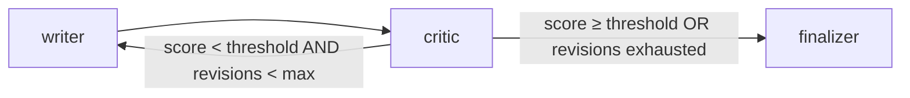

# Architecture — Proofline

Status: **linear flow built** (ADR-0012); **Measured Ops contract built** (C1,
ADR-0014). Sections 3–11 describe the content pipeline, which becomes the Measured
Ops content agent (ADR-0013). Section 14 describes Measured Ops itself: the
contract, the agent interface and the approval policy, with the supervisor, gate
and inbox to follow. Planned parts
are marked ⟶ with the `docs/PLAN.md` step that brings them, so the design doesn't
need to be torn up when they land.

## 1. What it does

Input: a topic and an audience. Output: one short technical script (title, hook,
body, call to action; at most 200 words by default) for a LinkedIn post and a
1-minute video, with inline citations, saved as Markdown + JSON.

A human is the final gate (the approval gate in C2, the inbox in C4). The machine's job is to get a draft good enough
that review is a 2-minute read, not a rewrite.

## 2. Three packages, one workspace

```
packages/
  proofline/        the content pipeline (LangGraph graph, nodes, CLI); becomes the
                    content agent in C8
  measured_ops/     Measured Ops: contracts, agent interface, approval policy (C1);
                    supervisor + gate (C2), inbox (C4)
  measured_evals/   eval + security layer: golden sets, metrics, cost budgets,
                    prompt-injection tests (evaluate() interface in C1; metrics in GROW-14)
```

Dependencies point one way: **proofline → measured_ops → measured_evals**, never
back (ADR-0014; `proofline` takes the `measured_ops` dependency in C8). The
supervisor gets agents injected, so `measured_ops` never imports `proofline`
(`packages/measured_ops/tests/test_ops_boundary.py`). `measured_evals` is published
as open source at launch and reused by a separate web app (Measured Lab), so it
can't know anything about either: `packages/measured_evals/tests/test_boundary.py`
fails if it declares or imports `proofline` or `measured_ops`, and CI installs it
alone and runs its tests (ADR-0012).

## 3. Graph

Built now:


⟶ The critic loop (C8, content agent) adds:



There is no human review node in this graph: the supervisor's approval gate (C2)
and the inbox (C4) approve what the content agent proposes, and a rejection with
feedback comes back as a new `Task` (ADR-0014, §13).

Routing is a pure function in `routing.py` (already implemented and tested):

| Router | Reads | Returns |
|---|---|---|
| `route_after_critic` | `score`, `revision_count`, `run_config` | `"writer"` \| `"finalizer"` |

`revision_count` = number of writer passes **after** the first draft. Backstop:
every invocation passes `recursion_limit` (default 40).

`build_graph()` uses the full `ScriptState` as its input schema: a narrower input
schema would drop the defaults `initial_state()` sets for later-week fields.

## 4. State

`state.py` — `ScriptState(TypedDict, total=False)`. TypedDict for the graph,
Pydantic for every value (ADR-0002). `initial_state(topic, audience, run_config)`
sets every default.

| Field | Type | Written by | Default / notes |
|---|---|---|---|
| `topic`, `audience` | `str` | input | |
| `run_config` | `RunConfig` | input | settings snapshot (models, thresholds, `max_words`, `brand_name`) so a resumed run behaves like it started (ADR-0004) |
| `outline` | `Outline` | planner | angle, key questions, search queries, 2–4 beats |
| `research_notes` | `ResearchNotes` | researcher | sources with code-assigned ids `S1..Sn`, findings citing them, gaps |
| `draft` | `Draft` | writer | title/hook/body/CTA; cited ids, word count, duration derived from the text |
| `revision_count` | `int` | writer | 0 |
| `critique` | `Critique \| None` | critic (C8) | `None` |
| `score` | `float \| None` | critic (C8) | `None`; = `Critique.overall`, computed in Python |
| `feedback` | `str \| None` | input (optional) | `None`; a human's feedback, set when a rejected action comes back as a revision `Task` (ADR-0014) |
| `final_script` | `FinalScript` | finalizer | rendered Markdown + metadata |
| `history` | `Annotated[list[RevisionRecord], operator.add]` | writer, critic | `[]`, append-only |

Rule: a node writes only the fields in its row (`state.FIELD_OWNERS`, checked by
`packages/proofline/tests/test_contracts.py`).

## 5. Node contracts

Every node: `async def node(state: ScriptState, runtime: Runtime[Deps]) -> dict`.

**planner** — reads `topic, audience, run_config`. One structured LLM call →
`Outline`. Prompt gets the brand name and word limit.

**researcher** — reads `topic, outline, run_config`. Calls
`deps.researcher.research(topic, outline, run_config)` (the `Researcher` port) and
then drops findings that cite unknown source ids, so every implementation gets that
guarantee (ADR-0007). Wired with `researcher.RETRY_POLICY` (3 attempts, retries only
`SearchUnavailableError`, ADR-0011). Implementations (`research/`):
- `StubResearcher` (default, `PROOFLINE_RESEARCHER=stub`): fixed, checked notes; no network.
  It reports the outline's key questions as gaps (it never researched them), and the CLI
  says research is stubbed.
- `WebResearcher` (`PROOFLINE_RESEARCHER=web`): runs the outline's queries concurrently
  through the `SearchClient` port (Tavily), dedupes by normalized URL, keeps the top
  `max_sources`, truncates, **assigns `S1..Sn` in code**, and makes one structured LLM
  call for findings. Sources reach the model inside escaped `<source>` tags, as
  untrusted data.
- ⟶ Content agent v1 (GROW-9): a web-search agent behind the same protocol; graph.py doesn't change.

**writer** — reads `outline, research_notes, run_config` (+ `draft, critique,
feedback` on revisions, from C8). Every factual claim cites a source id
inline (`[S3]`); citations live only in the text and are normalized, with unknown or
unparseable ones dropped and logged; titles carry no citations. Over `max_words` →
one more call (revision context kept) asking for a cut; the shorter draft is kept. Increments `revision_count` on revisions;
appends a `RevisionRecord(kind="draft")`.

**critic** (built; wired in C8) — scores against `docs/RUBRIC.md` (8 criteria,
integer 1–10, each with quoted evidence and a concrete fix). Writes `critique` and
`score`. `Critique.overall` is a weighted mean computed in Python with a **hard
gate**: `technical_accuracy < 6` caps it at 6. Validation requires each criterion
exactly once, so a malformed critique goes through the adapter's repair retry.

**finalizer** — deterministic, no LLM. Renders title, hook, body, call to action
and the cited sources as Markdown; writes `outputs/<thread_id>/script.md` and
`script.json` (overwrite, so retries are idempotent). `final_score` is `None` until
the critic runs.

## 6. Dependencies (runtime context)

`context.py`: `Deps(settings, llm: StructuredLLM, researcher: Researcher)`, passed as
`graph.ainvoke(..., context=deps)`. Nodes read `runtime.context`; nothing imports a
client at module level (ADR-0003). Tests build `Deps` with `FakeLLM`, and with
`StubResearcher` or a `WebResearcher` over `FakeSearch`.

`StructuredLLM.generate(prompt, schema, *, role, run_config) -> T`: one method.
`build_llm(settings)` picks the adapter from `PROOFLINE_LLM_PROVIDER` (only
`anthropic` today; an unknown provider or missing key fails before the run starts).
The Anthropic adapter maps `role` to the model and token limit from `RunConfig` (no
temperature by default, ADR-0015),
uses `with_structured_output(..., method="json_schema")`, retries once with the
validation error, and tags each call with the prompt name and version.

## 7. Configuration

All from environment / `.env` (`config.Settings`, prefix `PROOFLINE_`), snapshotted
into `RunConfig` at run start: brand name, word limit, researcher choice, model
provider and per-role models, thresholds. See `.env.example`.

## 8. Persistence (⟶ C2)

`checkpointing.open_checkpointer(url)`: `memory://` → `InMemorySaver`,
`sqlite:///…` → `AsyncSqliteSaver`, `postgresql://…` → `AsyncPostgresSaver`. All
use a `JsonPlusSerializer` whose `allowed_msgpack_modules` lists every state model
(ADR-0006). `thread_id` = run id (UUID4). The linear flow runs without a checkpointer.

## 9. Interfaces

**CLI** (`cli.py`, Typer):
- `proofline run --topic … --audience … [-v]` runs the graph and prints the Markdown
  script (stdout); file paths go to stderr.
- `proofline mermaid` prints the graph.
- No review prompt: approval happens in the supervisor's gate and inbox (ADR-0014).

**API** (`api.py`): `create_app(deps=..., checkpointer_url=...)` serves only
`GET /health` → `{status, checkpointer}`. The run and review endpoints planned here
were dropped (ADR-0014); the approval inbox (C4) is the human interface, and C4
decides where its app lives.

## 10. Observability

Every invocation sets `run_name="script-pipeline"`, `tags=[env]`,
`metadata={thread_id, prompt_versions, models}`; each LLM call is tagged with its
prompt name/version. Logging: stdlib `logging`, `proofline.*` loggers, one INFO line
per node (`proofline run -v`). ⟶ C7: tracing and cost per agent; GROW-15: cost
budgets and alerts via `measured_evals`.

## 11. Failure behavior

| Failure | Behavior |
|---|---|
| Invalid setting / unknown provider / missing API key | CLI prints the error (no traceback) and exits 1, before any call |
| Search timeout / 5xx / network (all queries) | `SearchUnavailableError` → RetryPolicy (3 attempts, backoff); then fails loudly |
| Search auth / quota / bad request | not retried; fails immediately |
| Search returns nothing usable | notes with `gaps` = the key questions; the writer says what's unclear |
| LLM returns invalid structure | adapter retries once with the validation error; then raises |
| LLM cites an unknown source id | dropped in code (findings and drafts), logged at WARNING |
| Draft over the word limit | one cut requested; the shorter draft is kept (the critic, wired in C8, scores length) |

## 12. Security baseline

- Web content is data, never instructions: escaped inside `<source>` and
  `<research_notes>` tags, with an explicit rule in every prompt that sees it; no
  tools in the linear flow, so injected instructions have nothing to act on. From
  C5, tool writes go through the approval policy.
- Secrets only from env; `.env` is unreadable to Claude Code (hooks + deny rules).
- ⟶ GROW-14/15 (`measured_evals`): prompt-injection suite, cost budgets, output checks;
  API auth and rate limiting in the app.

## 13. Measured Ops (`packages/measured_ops`, C1 contract; ADR-0014)

```
Task ──agent subgraph──▶ AgentResult(actions=[PendingAction, ...])
                               │
               policy.decide(action) ── "auto" ──▶ run            (C2)
                               │
                           "approval" ──▶ inbox ──▶ ApprovalDecision   (C2 gate, C4 inbox)
                                                       │
                                 rejected + feedback ──▶ new Task(feedback, parent_id)
```

**Contract** (`contracts.py`). Frozen Pydantic models, unknown fields rejected:

| Model | Fields | Rules |
|---|---|---|
| `Task` | `id`, `agent`, `goal`, `inputs` (JSON), `feedback`, `parent_id`, `created_at` | `agent` is snake_case; `feedback` needs a `parent_id` (a revision) |
| `PendingAction` | `id`, `task_id`, `type`, `target`, `preview`, `eval_scores`, `risk_level`, `created_at` | `type` is a policy key (snake_case); `risk_level` ∈ low/medium/high; `eval_scores` is `None` until C7 |
| `AgentResult` | `task_id`, `agent`, `status`, `summary`, `actions`, `error`, `finished_at` | failed ⇔ `error`; failed proposes no actions; every action belongs to this task; action ids unique |
| `ApprovalDecision` | `action_id`, `approved`, `feedback`, `decided_at` | the gate's resume value |

`OpsState` (TypedDict, ADR-0002): `task`; `results` and `decisions` with
`operator.add` reducers; `pending_actions` (replaced by the gate).
`initial_ops_state(task)` sets every field. `contracts.SERDE_ALLOWLIST` is built
from `STATE_TYPES` and must be passed to the supervisor's checkpointer (ADR-0006).

**Agent interface** (`agent.py`). An agent has a `name` and `build()` → a compiled
`StateGraph(PrivateState, input_schema=AgentInput, output_schema=AgentOutput)`:
input `{"task": Task}`, output `{"result": AgentResult}`, private state hidden.
`check_agent_graph(graph)` rejects other input/output keys; `run_agent(agent,
graph, task)` invokes it and rejects a result for another task or agent. Agents
propose actions; they never execute anything that leaves the system.

**Approval policy** (`policy.py`). A TOML table, `version = 1`, `[actions]` rows of
`"auto"` or `"approval"`. `load_policy()` reads the public demo table bundled at
`measured_ops/config/approval_policy.demo.toml` (rows from GROW-69);
`load_policy(path)` reads the private one. `decide(action)`: `risk_level="high"` →
approval; listed type → its row; **unlisted type → approval**.

**Evals** (`measured_evals.evaluate(output, context) -> EvalScores`, async). Plain
text and a plain mapping in, so the package knows no app types. `EvalScores`:
scores in [0, 1], a threshold, the evaluator name; `passed` is computed (every
score ≥ threshold, and at least one score). The C1 stub returns no scores, so it
never passes.

⟶ C2: `build_supervisor(agents, policy)`, gate with `interrupt()` before any
action that needs approval, Postgres checkpointer, e2e test
(`packages/measured_ops/tests/test_ops_e2e.py`, currently `C2 target`).

## 14. Docs

`docs/PLAN.md` (ordered steps), `docs/adr/` (decisions), `docs/PROMPTING.md` (prompt
standards), `docs/RUBRIC.md` (critic rubric), `docs/BRAND_VOICE.md` (voice, owned by
the host; the brand name itself is `PROOFLINE_BRAND_NAME`).
